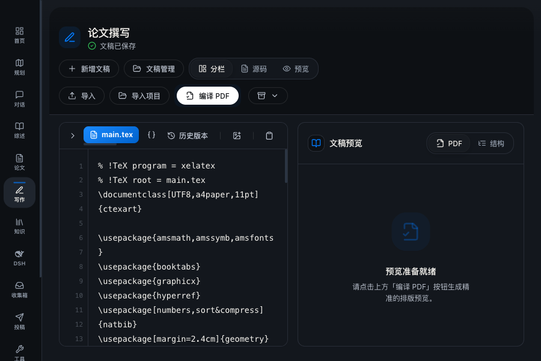
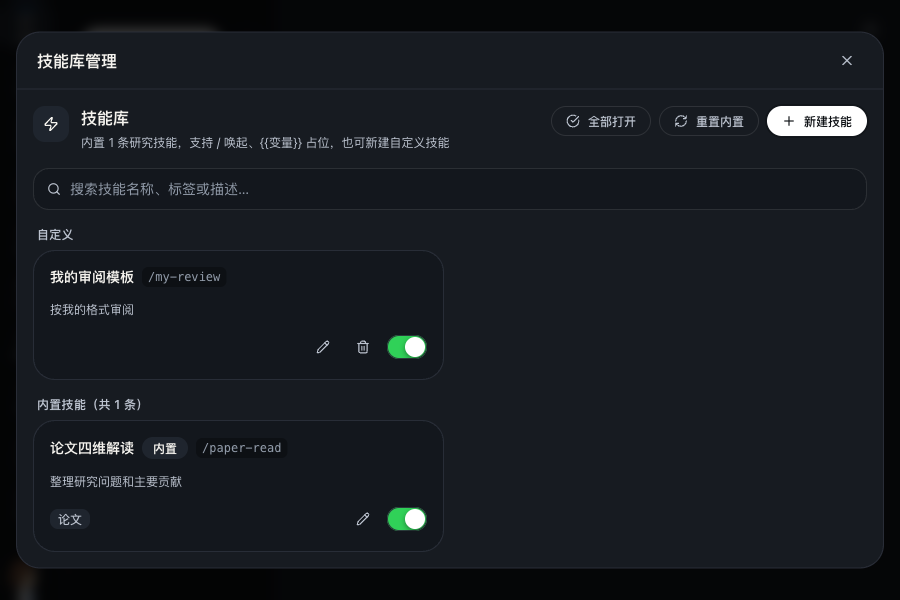

# 页面风格与对话技能库

## 页面风格

在「设置 → 界面布局 → 页面风格」中选择「柔和拟态」或「极简工作台」。风格立即应用，刷新或重新打开应用后保留；浅色、深色和跟随系统仍由外观主题控制。

极简工作台使用平面背景和清晰边界组织卡片、输入框与操作。设置分区会随窗口宽度换行；短窗口的侧边导航可以滚动。写作页工具栏可换行，窄窗口默认收起大纲侧栏，仍可从源码区展开，保留源码与预览的可读空间。

## 对话技能库

技能库管理位于对话输入框「技能」旁的「管理」按钮，普通对话与聚焦对话均可使用。设置页不再显示独立的技能模板分区。

- 「技能」或输入 `/` 用于选择当前要使用的模板。
- 「管理」中可搜索、新建、编辑、启用、禁用、删除和重置模板。修改会立即同步到当前对话的选择器。
- 禁用或删除当前选中的模板会清空选择与锁定状态；关闭技能库会保留尚未发送的聊天草稿。
- 模板默认仅作用于下一次发送，锁定后可连续使用；`{{变量}}` 占位符会在发送前提示填写。
- 工具技能仍执行对应工具流程；编辑技能库中的 PPT 提示词不会改变 PPT 生成器的专用提示词。

技能数据仍使用原有本地存储与接口，无数据迁移。历史记录若停留在设置中的技能分区，会自动回到「小妍」设置。

下图使用端到端测试中的示例模板：

